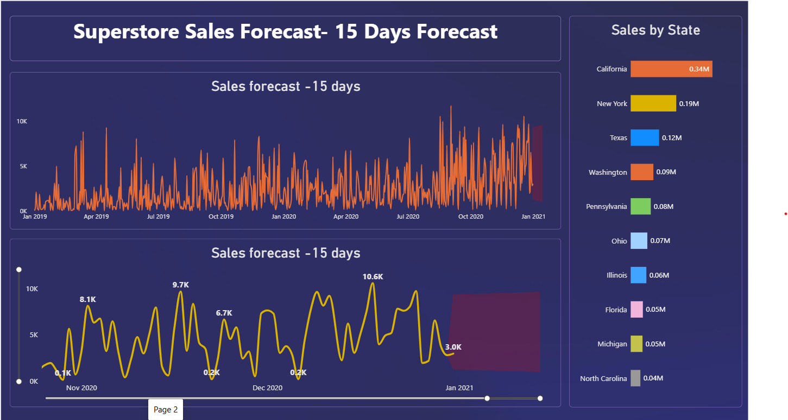
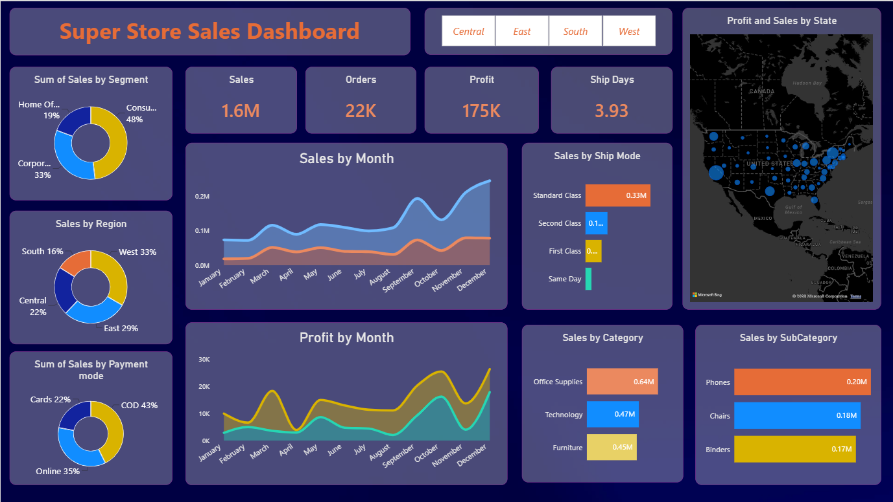

# Super-Store-Sales-Dashboard 

# Superstore Sales Analytics & Forecasting Dashboard

## 📌 Project Objectives
The primary objectives of this analytics and forecasting project are:
* **Performance Tracking:** To monitor and evaluate key performance indicators (KPIs) such as revenue, order volume, and profitability across different dimensions.
* **Customer Segmentation:** To identify the most profitable customer groups (Consumer, Corporate, Home Office) and understand their purchasing behavior.
* **Geographical Expansion:** To pinpoint top-performing states and regions to optimize marketing budgets and supply chain logistics.
* **Product Optimization:** To analyze sales distribution by product categories and sub-categories to manage stock availability effectively.
* **Sales Forecasting:** To leverage historical data models to predict sales for the next 15 days, enabling proactive inventory management and financial planning.

---

## ## 📊 Dashboard Visualizations

### Page 1: Super Store Sales Dashboard
This view provides a high-level retrospective look at historical performance metrics and distribution across various operational segments:

* **Core KPI Metrics:** 
  * **Total Sales:** 1.6M
  * **Total Orders:** 22K
  * **Total Profit:** 175K
  * **Average Ship Days:** 3.93 Days
* **Sales Distribution Analysis:**
  * **By Segment:** Driven heavily by the *Consumer* market (48%), followed by *Corporate* (33%) and *Home Office* (19%).
  * **By Region:** The *West* (33%) and *East* (29%) regions contribute to more than 60% of total revenue.
  * **By Payment Mode:** *COD (Cash on Delivery)* leads with 43%, followed by *Online* (35%) and *Cards* (22%).
* **Product Insights:**
  * *Office Supplies* is the highest volume category ($0.64M).
  * *Phones* ($0.20M) and *Chairs* ($0.18M) dominate the sub-category revenue stream.
* **Seasonality Trends:** Sales and profits showcase cyclical growth, peaking sharply during the year-end holiday season (November and December).

### Page 2: Superstore Sales Forecast Dashboard
This view focuses on forward-looking predictions and high-value geographical breakdowns:

* **15 Days Sales Forecast:** A time-series predictive line graph charting daily operational sales trends and forecasting demand up to early January 2021.
* **Sales by State:** Highlights geographical powerhouses where *California* ($0.34M) and *New York* ($0.19M) stand out as the top revenue generators.

---

## 📁 Data Source Schema
The dashboard relies on a comprehensive transaction registry dataset (`Superstore.csv`) containing the following core attributes:

| Column Name | Description |
| :--- | :--- |
| **Row ID / Order ID** | Unique identifiers for rows and individual customer orders |
| **Order Date / Ship Date** | Timestamps tracking transaction placement and dispatch timelines |
| **Ship Mode** | Logistics classes chosen (Standard Class, Second Class, First Class, Same Day) |
| **Segment** | Categorization of the purchasing audience (Consumer, Corporate, Home Office) |
| **State / Region / City** | Granular geographical metadata of the delivery location |
| **Category / Sub-Category**| Hierarchical grouping of products (Furniture, Office Supplies, Technology) |
| **Sales** | Gross monetary value generated per transaction |
| **Quantity / Profit** | Number of items purchased and final net financial return |
| **Payment Mode** | Mode of financial transaction processing |

---

## 💡 Strategic Business Recommendations
* **Inventory Control:** Align warehouse replenishment schedules with the projected spikes shown in the 15-day sales forecast curve to avoid stockouts.
* **Targeted Marketing:** Direct promotional campaigns toward California and New York, capitalizing on existing market dominance.
* **Cash Flow Management:** Since COD comprises 43% of the payment landscape, operationalize strict cash collection protocols within shipping loops.
